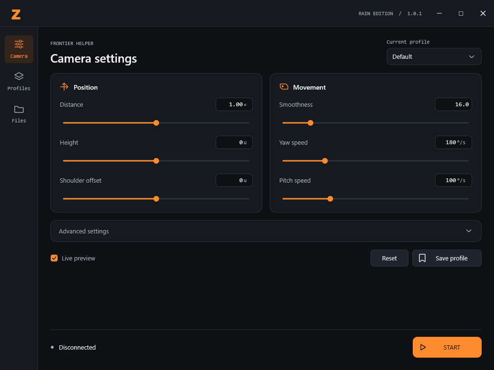

# Frontier Helper

Native camera helper for Monster Hunter Frontier Rain HD. Version **1.0.0**.



[Download Frontier Helper 1.0.0](https://github.com/Tychkaneg/Frontier-helper/releases/download/v1.0.0/Frontier-Helper-1.0.0.zip).
Close Rain and Helper before updating, extract the ZIP and run
`FrontierHelper.exe`. Keep `FrontierOrbitRain08.dll` next to it and preserve
your existing `setups` folder. Open Rain normally, enter the city, then click
**START**.

## Xbox LT / RT support

LT maps to Rain's existing L2 binding, and RT maps to R2. The triggers work
independently and together. Helper reads separate XInput trigger values and
updates the DirectInput joystick state returned inside the running game.
It reads the existing controller bindings and priority without installing
or modifying files in the Rain Client folder.

Connect the controller before clicking START. Trigger translation stays
active while Helper is connected and Rain has focus. STOP or F8 can disable
the orbit camera while the input fix remains connected; closing Helper or
losing the connection stops translation. Pressed means above 30 out of 255.

Use the matched EXE and DLL from this release. The local control protocol is
now version 2, so restart Rain when updating from an older injected module.

## Rain update compatibility

Compatibility is checked against the loaded engine in both Helper and the
injected camera module; the file SHA256 is recorded for diagnostics.
Updates are accepted automatically when the known camera/collision layout
passes 13 exact code and address-operand checks plus 9 mapped-data checks.
The original camera import, process identity and local control-channel owner
are also checked before enabling the camera.

Changes to checked code or addresses are rejected. Automatic compatibility
does not relocate hooks or adapt arbitrary engine changes.

## Build and verification

Use Zig 0.13.0 on Windows, with `zig` on PATH or pass its location:

```powershell
cd app
.\build.ps1 -Zig 'C:\Tools\zig\zig.exe'
.\test-compat.ps1 -Zig 'C:\Tools\zig\zig.exe'
# Optional: real DirectInput trigger tests with an Xbox controller connected
.\test-compat.ps1 -Zig 'C:\Tools\zig\zig.exe' -ControllerTests
```

The build produces both the application and its Rain camera DLL.
Tests cover compatibility acceptance/rejection and camera-core geometry.
Optional `-GamePid <pid>` adds a read-only check of a running Rain engine.
Controller tests cover pre-existing ANSI/Unicode DirectInput devices,
separate/simultaneous triggers, threshold, release, other-button preservation,
connection gating and hook restoration.

On 2026-10-11 the user confirmed LT/L2 and RT/R2 worked separately and
together in Rain HD `20261009170842_c176749` using the preceding 0.10.2 test
build. Its journal recorded patched 80-byte joystick states and active
camera scenes. Version 1.0.0 retains that input and camera implementation.
See [trigger verification](app/verification/triggers-1.0.0.json) and the
[previous compatibility verification](app/verification/compatibility-0.10.1.json).
